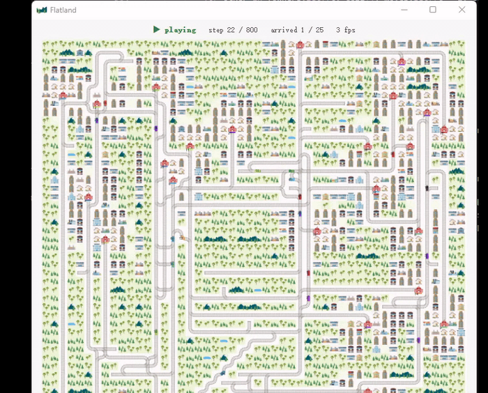

# Multi-Agent Railway Path Planning

A multi-agent pathfinding project developed for **FIT5222 Planning and Automated Reasoning** at Monash University using the Flatland railway simulation environment.

The goal was to coordinate multiple trains through a shared railway network while avoiding collisions, considering arrival deadlines, and handling runtime malfunctions.

> The original coursework source code is kept private to comply with university academic integrity requirements. This repository is a portfolio overview of the project.

## What I Implemented

- Built a **space-time A\*** planner using states containing position, direction, and timestep.
- Precomputed goal distances with **reverse BFS** over the directed railway graph to improve the A* heuristic.
- Used **vertex and edge reservations** to prevent collisions between previously planned trains.
- Compared several **prioritized planning orders**, including deadline-slack and path-distance based strategies.
- Implemented **malfunction-aware replanning** that propagates delays through affected routes instead of replanning the entire system from scratch.
- Added limited **local route replanning** to improve expensive or delayed paths.

## System Overview

Rail Graph  
→ Reverse BFS Heuristic  
→ Space-Time A*  
→ Reservation-Based Planning  
→ Agent Prioritisation  
→ Dynamic Replanning

## Technologies

*Python · Flatland · NumPy · A\* · BFS · Multi-Agent Pathfinding*
## Demo

## Possible Improvements

One extension I would like to explore is **Safe Interval Path Planning (SIPP)** as an alternative to explicitly expanding the time dimension, particularly for larger planning horizons.

---

**FIT5222 — Planning and Automated Reasoning**  
Monash University, 2026
